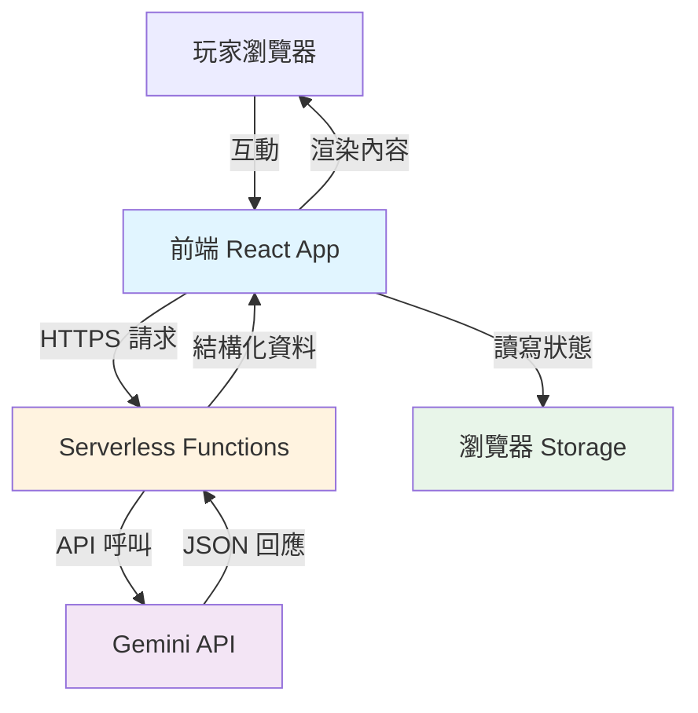

# 技術設計文件

## Overview

聊齋夜話是一個單頁網頁應用程式（SPA, Single Page Application，網頁不用重新載入就能切換內容的應用程式），使用 AI 驅動的互動式故事引擎。系統採用前後端分離架構：

- **Frontend（前端）**：在瀏覽器中運行的 React（一個用來建立網頁介面的 JavaScript 框架）應用程式，負責顯示故事內容、處理使用者互動、呈現古書美學介面
- **Backend（後端）**：Serverless Functions（無伺服器函式，不需要自己管理伺服器的後端程式），作為 Gemini AI 的代理，保護 API 金鑰並驗證請求
- **AI 引擎**：Google Gemini 3.5 Flash-Lite，負責生成故事場景、選擇選項和翻譯

### 核心設計原則

1. **簡單優先**：選擇容易理解和部署的技術，適合初學者
2. **安全第一**：API 金鑰（用來存取 AI 服務的密碼）永不暴露在瀏覽器程式碼中
3. **免費部署**：整個應用程式可免費部署到 Vercel 或 Netlify（兩個提供免費網站託管服務的平台）
4. **效能考量**：最小化 AI 請求次數，快取（cache，暫存）翻譯結果
5. **優雅降級**：AI 配額用盡時提供預寫的備用場景

## Architecture

### 高階架構圖



### 元件說明

#### 1. Frontend（前端應用程式）
- **技術棧（使用的技術）**：React 18+、TypeScript（帶有型別檢查的 JavaScript，可以在寫程式時就發現錯誤）、CSS-in-JS（把 CSS 樣式寫在 JavaScript 裡的方法）或 Tailwind CSS（一套現成的 CSS 樣式工具）
- **職責（負責做的事）**：
  - 渲染書本風格的使用者介面（UI）和動畫效果
  - 管理本地故事狀態（在瀏覽器裡記住目前故事進行到哪裡）
  - 處理使用者點擊和選擇
  - 快取（暫存）翻譯結果，避免重複請求
  - 顯示載入狀態和錯誤訊息

#### 2. Backend API（後端 API）
- **技術棧**：Vercel Serverless Functions（或 Netlify Functions）、Node.js（一個可以讓 JavaScript 在伺服器上運行的環境）
- **端點（Endpoints，API 的網址路徑）**：
  - `POST /api/story`：請求新場景或選擇的後續內容
  - `POST /api/translate`：請求句子翻譯（如果還沒有快取的話）
- **職責**：
  - 從環境變數（environment variables，儲存在伺服器上的設定值）讀取 API 金鑰
  - 驗證請求的格式和內容是否正確
  - 呼叫 Gemini API
  - 處理錯誤和重試邏輯（如果失敗就再試幾次）
  - 回傳結構化的 JSON（一種資料格式）

#### 3. Story Engine（故事引擎）
- **位置**：前端元件
- **職責**：
  - 維護當前場景狀態（記住現在故事進行到哪裡）
  - 追蹤玩家選擇歷史（記錄玩家做過哪些選擇）
  - 判斷下一個場景或結局
  - 管理故事分支邏輯（根據玩家的選擇決定故事走向）
  - 持久化（儲存）和恢復遊戲進度

#### 4. AI Narrator（AI 說書人）
- **實作（實現方式）**：Gemini API 整合在後端
- **職責**：
  - 根據故事情境生成場景描述
  - 提供 3 個選擇選項
  - 生成文言文風格的結局故事
  - 將文言文翻譯成現代中文和英文

#### 5. Translation Service（翻譯服務）
- **實作**：前端元件 + 後端 API
- **職責**：
  - 管理翻譯快取（用 sessionStorage 暫存翻譯結果）
  - 請求還沒有快取的翻譯
  - 顯示和隱藏翻譯覆蓋層

#### 6. UI Renderer（UI 渲染器）
- **實作**：React 元件
- **職責**：
  - 渲染古書視覺效果
  - 實作翻頁動畫
  - 顯示燭光和符咒元素
  - 響應式佈局（Responsive Layout，自動適應不同螢幕大小，從手機到桌面都能正常顯示）

## Components and Interfaces

### 前端元件樹

```
App
├── BookContainer（書本容器）
│   ├── PageWrapper（頁面包裝器）
│   │   ├── CandleEffect（燭光效果）
│   │   ├── TalismanDecoration（符咒裝飾）
│   │   └── CurrentPage（當前頁面）
│   │       ├── SceneView（場景檢視）
│   │       │   ├── NarrativeText（敘事文字）
│   │       │   └── ChoiceButtons（選擇按鈕）
│   │       └── EndingView（結局檢視）
│   │           ├── ClassicalText（文言文文字）
│   │           │   └── InteractiveSentence（可點擊句子）
│   │           ├── ModernChinese（現代中文）
│   │           └── EnglishTranslation（英文翻譯）
│   └── PageTurnAnimation（翻頁動畫）
├── TranslationOverlay（翻譯覆蓋層）
├── LoadingIndicator（載入指示器）
└── ErrorMessage（錯誤訊息）
```

### 核心介面定義（TypeScript）

```typescript
// 場景類型
interface Scene {
  id: string;
  type: 'narrative' | 'ending';
  content: string;  // 敘事文字
  choices?: Choice[];  // 如果是 narrative 類型，有 3 個選擇
  classicalText?: string;  // 如果是 ending 類型，文言文內容
  modernChinese?: string;  // 現代中文翻譯
  englishTranslation?: string;  // 英文翻譯
  creatureType?: 'fox-spirit' | 'painted-skin' | 'jiangshi';  // 遭遇的妖怪類型
}

// 選擇選項
interface Choice {
  id: string;
  text: string;
  nextSceneId: string;
}

// 故事狀態
interface StoryState {
  currentSceneId: string;
  choiceHistory: string[];  // 已做出的選擇 ID
  creatureEncountered: 'fox-spirit' | 'painted-skin' | 'jiangshi' | null;
  isComplete: boolean;
}

// 翻譯資料
interface Translation {
  original: string;  // 原始文言文句子
  modernChinese: string;
  english: string;
}

// API 請求格式
interface StoryRequest {
  currentSceneId: string | null;  // null = 遊戲開始
  choiceId: string | null;  // 玩家選擇的選項
  storyState: StoryState;
}

// API 回應格式
interface StoryResponse {
  scene: Scene;
  error?: string;
}

interface TranslateRequest {
  sentence: string;
  context: string;  // 整段文言文，幫助 AI 理解情境
}

interface TranslateResponse {
  translation: Translation;
  error?: string;
}
```

### API 端點規格

#### POST /api/story

**請求 Body（請求主體，送給伺服器的資料）：**
```json
{
  "currentSceneId": "scene-01" | null,
  "choiceId": "choice-a" | null,
  "storyState": {
    "currentSceneId": "scene-01",
    "choiceHistory": ["choice-a", "choice-b"],
    "creatureEncountered": "fox-spirit" | null,
    "isComplete": false
  }
}
```

**回應（成功時）：**
```json
{
  "scene": {
    "id": "scene-02",
    "type": "narrative",
    "content": "月色朦朧，你走在荒郊野外...",
    "choices": [
      { "id": "choice-a", "text": "繼續前行", "nextSceneId": "scene-03" },
      { "id": "choice-b", "text": "尋找客棧", "nextSceneId": "scene-04" },
      { "id": "choice-c", "text": "原地休息", "nextSceneId": "scene-05" }
    ],
    "creatureType": "fox-spirit"
  }
}
```

**回應（結局時）：**
```json
{
  "scene": {
    "id": "ending-fox-good",
    "type": "ending",
    "classicalText": "書生遇狐仙，共譜良緣。異日歸故里，夫妻偕老，子孫滿堂。",
    "modernChinese": "書生遇到了狐仙，兩人結為夫妻...",
    "englishTranslation": "The scholar met the fox spirit and they became husband and wife...",
    "creatureType": "fox-spirit"
  }
}
```

**回應（錯誤時）：**
```json
{
  "scene": null,
  "error": "AI 配額已用完，請稍後再試"
}
```

#### POST /api/translate

**請求 Body：**
```json
{
  "sentence": "書生遇狐仙，共譜良緣。",
  "context": "書生遇狐仙，共譜良緣。異日歸故里，夫妻偕老，子孫滿堂。"
}
```

**回應：**
```json
{
  "translation": {
    "original": "書生遇狐仙，共譜良緣。",
    "modernChinese": "書生遇到了狐仙，兩人結為夫妻。",
    "english": "The scholar met the fox spirit and they became husband and wife."
  }
}
```

## Data Models

### 故事圖結構

故事採用**有向圖（Directed Graph）**結構，每個節點是一個場景，邊代表選擇：

```
[開場場景]
    ├─ 選擇 A ──> [遇到狐仙的場景]
    │                 ├─ 選擇 A ──> [結局：良緣]
    │                 ├─ 選擇 B ──> [結局：被騙]
    │                 └─ 選擇 C ──> [結局：逃脫]
    │
    ├─ 選擇 B ──> [遇到畫皮妖的場景]
    │                 ├─ 選擇 A ──> [結局：被吃]
    │                 ├─ 選擇 B ──> [結局：道士相救]
    │                 └─ 選擇 C ──> [結局：智取]
    │
    └─ 選擇 C ──> [遇到殭屍的場景]
                      ├─ 選擇 A ──> [結局：變成殭屍]
                      ├─ 選擇 B ──> [結局：符咒鎮壓]
                      └─ 選擇 C ──> [結局：天亮得救]
```

### 資料持久化策略

#### SessionStorage（會話儲存）
用於存放遊戲進度和翻譯快取：

```typescript
// 鍵值（key，用來識別不同資料的名稱）
const STORAGE_KEYS = {
  STORY_STATE: 'liaozhai-story-state',
  TRANSLATION_CACHE: 'liaozhai-translations',
  CURRENT_SCENE: 'liaozhai-current-scene'
};

// 存入範例
sessionStorage.setItem(STORAGE_KEYS.STORY_STATE, JSON.stringify(storyState));

// 讀取範例
const savedState = JSON.parse(sessionStorage.getItem(STORAGE_KEYS.STORY_STATE));
```

#### 為何選擇 SessionStorage？
1. **不需要後端資料庫**：簡化架構，符合「簡單部署」原則
2. **適合短期遊戲**：單次遊戲約 10-15 分鐘，關閉分頁後清除資料是合理的
3. **隱私友善**：不會跨裝置追蹤玩家
4. **降低成本**：無需資料庫服務，完全免費

### 備用場景資料

當 AI 配額用盡時，使用預先撰寫的場景：

```typescript
// 存放在前端程式碼中的備用資料
const FALLBACK_SCENES = {
  opening: {
    id: 'fallback-opening',
    type: 'narrative',
    content: '科舉在即，書生趕路。忽聞林中傳來異響...',
    choices: [/* ... */]
  },
  endings: {
    'fox-good': {
      id: 'fallback-ending-fox-good',
      type: 'ending',
      classicalText: '書生遇狐仙，共譜良緣...',
      modernChinese: '書生遇到了狐仙...',
      englishTranslation: 'The scholar met the fox spirit...'
    },
    // 至少準備 3 個結局的備用版本
  }
};
```

## Correctness Properties

*屬性（Property）是指在所有有效執行中都應成立的特性或行為——本質上是關於系統應該做什麼的正式陳述。屬性是人類可讀的規格書與機器可驗證的正確性保證之間的橋樑。*

### 正確性預作業（Prework）

在撰寫屬性之前，我需要先使用 prework 工具分析所有驗收標準的可測試性。這個步驟是為了：
1. 確認每個需求是否可以被自動化測試
2. 決定適合使用屬性測試（Property-Based Testing）還是範例測試（Example-Based Testing）
3. 找出可以用程式驗證的不變量（Invariants，永遠應該成立的規則）


### 屬性反思（Property Reflection）

檢查已識別的屬性，尋找邏輯上重複或可以合併的項目（這樣可以減少測試數量，同時保持完整的覆蓋率）：

**冗餘分析（找出重複的測試）：**

1. **結局資料完整性** (3.2, 3.3)：這兩個屬性都在檢查結局場景的翻譯欄位是否存在。可以合併成一個屬性：「所有結局場景必須包含完整的翻譯（現代中文和英文）」。

2. **翻譯覆蓋層內容** (4.2, 4.3)：這兩個屬性都在檢查覆蓋層顯示的內容。可以合併成一個屬性：「翻譯覆蓋層必須同時顯示現代中文和英文翻譯」。

3. **載入指示器** (11.2, 11.5)：這是重複的需求，合併為一個屬性。

4. **故事狀態不變量** (1.5, 1.6)：這兩個都是關於遊戲狀態的不變量，但檢查不同方面（生物類型唯一性 vs. 結局完成狀態），應該保持分開，因為它們驗證不同的規則。

5. **狀態持久化** (10.1, 10.4)：10.4 是 10.1 的特例（結局時的持久化），可以合併成一個更通用的屬性：「任何狀態變化都應該持久化到 sessionStorage」。

6. **觸控目標尺寸與文字可讀性** (6.3, 6.4)：這兩個都是檢查 UI 元素尺寸的通用規則，但目標不同（文字 vs. 按鈕），應該保持分開以確保兩方面都被覆蓋到。

**合併後的屬性列表：**
- 將 3.2 和 3.3 合併為「結局翻譯完整性」
- 將 4.2 和 4.3 合併為「翻譯覆蓋層雙語顯示」
- 將 10.1 和 10.4 合併為「狀態變化持久化」
- 刪除重複的 11.5

### Property 1: 場景選擇數量一致性

*對於任何* narrative 類型的場景，渲染後的 UI 應該顯示恰好 3 個可點擊的選擇按鈕。

**Validates: Requirements 1.2**

### Property 2: 選擇驅動的狀態轉換

*對於任何* 有效的場景和選擇組合，Story_Engine 處理該選擇後應該轉換到 nextSceneId 指定的場景。

**Validates: Requirements 1.3**

### Property 3: 生物類型唯一性不變量

*對於任何* 遊戲過程（從開場到結局的選擇序列），creatureEncountered 欄位只能被設定一次，且在遊戲過程中保持不變。

**Validates: Requirements 1.5**

### Property 4: 結局完成狀態不變量

*對於任何* ending 類型的場景，其 isComplete 屬性必須為 true，且 choices 欄位必須為空或 undefined。

**Validates: Requirements 1.6**

### Property 5: 結局文言文顯示

*對於任何* ending 類型的場景，UI 渲染結果必須包含該場景的 classicalText 內容。

**Validates: Requirements 3.1**

### Property 6: 結局翻譯完整性

*對於任何* ending 類型的場景，必須同時存在非空的 modernChinese 和 englishTranslation 欄位。

**Validates: Requirements 3.2, 3.3**

### Property 7: 句子互動性

*對於任何* 顯示的文言文段落，每個句子元素都應該具有點擊事件處理器（onClick handler，當使用者點擊時會執行的程式）。

**Validates: Requirements 4.1**

### Property 8: 翻譯覆蓋層雙語顯示

*對於任何* 點擊句子後顯示的翻譯覆蓋層，必須同時包含該句子的現代中文翻譯和英文翻譯。

**Validates: Requirements 4.2, 4.3**

### Property 9: 翻譯覆蓋層切換行為

*對於任何* 已顯示翻譯覆蓋層的句子，再次點擊該句子應該隱藏覆蓋層。

**Validates: Requirements 4.6**

### Property 10: 響應式文字可讀性

*對於任何* 視口寬度（viewport width，瀏覽器視窗的寬度，從手機到桌面電腦），所有文字元素的計算後字體大小必須 >= 最小可讀值（14px）。

**Validates: Requirements 6.3**

### Property 11: 觸控目標尺寸

*對於任何* 可點擊或可觸控的 UI 元素，在行動裝置視口（寬度 < 768px）下，其尺寸必須 >= 44x44 像素（WCAG 2.1 AAA 無障礙標準的建議值，確保手指容易點到）。

**Validates: Requirements 6.4**

### Property 12: API 請求驗證

*對於任何* 傳入後端 API 的請求，如果請求格式無效（缺少必要欄位或類型錯誤），後端應該回傳 HTTP 400 錯誤而不呼叫 Gemini API（避免浪費 API 配額）。

**Validates: Requirements 8.4**

### Property 13: 狀態變化持久化

*對於任何* 故事狀態的變化（場景轉換、選擇記錄、完成狀態），變化後的狀態應該立即寫入 sessionStorage。

**Validates: Requirements 10.1, 10.4**

### Property 14: 選擇歷史追蹤

*對於任何* 玩家做出的選擇序列，storyState.choiceHistory 陣列應該按順序包含所有選擇的 ID。

**Validates: Requirements 10.3**

## Error Handling

### 錯誤分類

系統需要處理三類錯誤：

#### 1. AI 服務錯誤
- **Gemini API 配額用盡（HTTP 429，Too Many Requests）**
- **Gemini API 伺服器錯誤（5xx，伺服器內部錯誤）**
- **Gemini API 金鑰無效（401/403，未授權或拒絕存取）**
- **請求超時（Timeout，超過 20 秒沒有回應）**

#### 2. 網路錯誤
- **前端到後端的連線失敗**
- **後端到 Gemini 的連線失敗**
- **DNS 解析失敗（Domain Name System，無法找到網址對應的伺服器）**

#### 3. 應用程式錯誤
- **無效的故事狀態（資料格式錯誤）**
- **翻譯快取讀取失敗**
- **SessionStorage 已滿（瀏覽器儲存空間不足）**

### 錯誤處理策略

#### AI 服務錯誤處理

```typescript
// 後端重試邏輯（如果失敗就自動重試幾次）
async function callGeminiWithRetry(
  prompt: string,
  maxRetries: number = 3  // 最多重試 3 次
): Promise<GeminiResponse> {
  const delays = [2000, 5000, 15000]; // 等待時間：2 秒, 5 秒, 15 秒
  
  for (let i = 0; i < maxRetries; i++) {
    try {
      const response = await geminiClient.generateContent(prompt);
      return response;
    } catch (error) {
      // 檢查是否為可重試錯誤
      if (error.status === 429 || error.status >= 500) {
        // 尊重 retry-after header（伺服器告訴我們要等多久）
        const retryAfter = error.headers?.['retry-after'];
        const delay = retryAfter 
          ? parseInt(retryAfter) * 1000 
          : delays[i];
        
        if (i < maxRetries - 1) {
          await sleep(delay);  // 等待一段時間後再試
          continue;
        }
      }
      
      // 不可重試的錯誤或重試次數用盡
      throw error;
    }
  }
  
  throw new Error('Max retries exceeded');
}

// 備用場景機制（當 AI 無法使用時的替代方案）
function getFallbackScene(sceneId: string): Scene {
  // 從預寫的備用場景中選擇
  return FALLBACK_SCENES[sceneId] || FALLBACK_SCENES.opening;
}
```

#### 前端錯誤顯示

```typescript
interface ErrorState {
  type: 'ai-quota' | 'network' | 'server' | 'translation';
  message: {
    zh: string;
    en: string;
  };
  recoverable: boolean;  // 是否可以恢復（是否能重試）
  retryAction?: () => void;  // 重試的動作
  fallbackScene?: Scene;  // 備用場景
}

// 錯誤訊息元件
function ErrorMessage({ error }: { error: ErrorState }) {
  return (
    <div className="error-talisman">
      <div className="error-text-zh">{error.message.zh}</div>
      <div className="error-text-en">{error.message.en}</div>
      
      {error.recoverable && error.retryAction && (
        <button onClick={error.retryAction}>
          重試 / Retry
        </button>
      )}
      
      {error.fallbackScene && (
        <button onClick={() => loadFallbackScene(error.fallbackScene)}>
          繼續備用故事 / Continue with fallback
        </button>
      )}
    </div>
  );
}
```

### 特定錯誤處理

#### 配額用盡處理

當 Gemini API 回傳 429（配額用盡，Too Many Requests）：
1. 後端回傳特殊錯誤碼
2. 前端顯示友善訊息：「蠟燭閃爍…說書人需要休息。請一分鐘後再試。」
3. 提供「載入備用故事」選項
4. 自動切換到預寫的備用場景，讓遊戲可以繼續

#### 翻譯失敗處理

當翻譯 API 失敗：
1. 顯示原始文言文文字（不隱藏內容）
2. 在句子旁顯示小圖示（❌）表示翻譯不可用
3. 覆蓋層顯示：「翻譯暫時無法使用 / Translation temporarily unavailable」
4. 提供重試按鈕

#### SessionStorage 錯誤處理

當 sessionStorage 已滿或不可用：
1. 捕捉 QuotaExceededError（儲存空間超出限制的錯誤）
2. 清除舊的翻譯快取（保留故事狀態，因為故事狀態更重要）
3. 如果仍失敗，僅在記憶體中維護狀態（不儲存到硬碟）
4. 顯示警告：「無法保存進度，關閉分頁後將遺失。」

### 錯誤訊息美學設計

所有錯誤訊息都設計成「符咒警示」風格：
- 紅色或淡黃色背景（宣紙紋理）
- 黑色墨筆字體
- 符咒圖案邊框
- 雙語顯示（繁體中文 + 英文）
- 保持與應用程式整體美學一致

## Testing Strategy

### 測試方法評估

本專案結合以下測試方法：

#### 1. 屬性測試（Property-Based Testing，簡稱 PBT）
用於驗證系統的通用不變量（永遠應該成立的規則）和行為規則。

**PBT 適用性評估：**
- ✅ **適合**：Story_Engine 的狀態轉換邏輯、UI 渲染規則、資料驗證
- ✅ **適合**：響應式佈局規則、互動行為一致性
- ❌ **不適合**：AI 生成內容品質（這是主觀評估，無法用程式自動判斷）
- ❌ **不適合**：視覺美學檢查（需要人工審閱，程式無法判斷「好不好看」）
- ❌ **不適合**：實際網路效能測量（太多外在因素影響）

**選擇的 PBT 框架：** **fast-check**（JavaScript/TypeScript 的屬性測試工具）
- 成熟穩定，廣泛使用
- 與 Jest 或 Vitest（測試框架）無縫整合
- 支援複雜的資料生成器（可以自動生成各種測試資料）
- 良好的錯誤縮減（shrinking）能力（找到最小的失敗案例）

**PBT 配置：**
```typescript
import fc from 'fast-check';

// 每個屬性測試至少 100 次迭代（用 100 組不同的隨機資料來測試）
fc.configureGlobal({ numRuns: 100 });

// 標記格式：Feature: liaozhai-nights, Property {number}: {property_text}
describe('Feature: liaozhai-nights, Property 1: 場景選擇數量一致性', () => {
  it('對於任何 narrative 場景，應顯示恰好 3 個選擇', () => {
    fc.assert(
      fc.property(
        narrativeSceneArbitrary(),  // 隨機生成場景資料
        (scene) => {
          const rendered = renderScene(scene);
          const choices = rendered.querySelectorAll('.choice-button');
          return choices.length === 3;
        }
      )
    );
  });
});
```

#### 2. 範例測試（Example-Based Unit Tests）
用於具體的行為驗證和邊界情況（特殊的、極端的案例）。

**範例測試用途：**
- 初始化行為（開場場景）
- 特定錯誤處理場景
- 響應式斷點切換（從手機寬度變成桌面寬度時的行為）
- 重置功能
- UI 互動範例

**測試框架：** **Vitest**（與 Vite 完美整合，速度快的測試工具）

#### 3. 整合測試（Integration Tests）
用於驗證前後端互動和外部服務整合（測試不同元件之間的合作是否正常）。

**整合測試範圍：**
- 後端 API 端點（使用 mock Gemini API，不實際呼叫 AI 服務）
- 前端到後端的請求流程
- 錯誤處理和重試邏輯
- SessionStorage 持久化

#### 4. 視覺測試（Visual/Snapshot Tests）
用於捕捉 UI 迴歸（介面是否意外改變）。

**視覺測試工具：** **Storybook** + **Chromatic**（或 **Playwright**）
- 捕捉元件的視覺快照（截圖）
- 檢測非預期的樣式變化（有沒有不小心改壞版面）
- 驗證響應式佈局
- 測試動畫效果

#### 5. 煙霧測試（Smoke Tests）
用於基本設定和架構檢查（快速檢查系統是否能正常運作）。

**煙霧測試項目：**
- 檔案結構檢查（.kiro 資料夾存在、LICENSE 檔案存在）
- API 金鑰不在前端程式碼中（安全性檢查）
- 環境變數配置檢查
- 依賴項完整性（所有需要的套件都有安裝）

### 測試覆蓋目標

| 測試類型 | 目標覆蓋率 | 說明 |
|---------|-----------|------|
| 屬性測試 | 14 個屬性全部實作 | 核心邏輯的不變量（永遠應該成立的規則） |
| 單元測試 | 80%+ 程式碼覆蓋 | Story_Engine, Translation_Service 等元件 |
| 整合測試 | 所有 API 端點 | /api/story, /api/translate |
| 視覺測試 | 主要元件 | BookContainer, SceneView, EndingView, ErrorMessage |
| 煙霧測試 | 100% 設定項目 | 安全性、架構、文件 |

### 測試執行策略

#### 開發階段
```bash
# 執行單元測試（含屬性測試）
npm run test

# 監視模式（開發時持續執行，一改程式碼就自動重新測試）
npm run test:watch

# 執行整合測試
npm run test:integration

# 執行所有測試
npm run test:all
```

#### CI/CD 階段（Continuous Integration / Continuous Deployment，自動化測試和部署）
```yaml
# GitHub Actions 範例
- name: Run all tests
  run: |
    npm run test:all
    npm run test:visual
    npm run build
    npm run test:smoke
```

### 測試資料生成器（Arbitraries）

使用 fast-check 建立測試資料生成器（自動產生各種測試用的場景、選擇、狀態等資料）：

```typescript
// 生成隨機的 narrative 場景
const narrativeSceneArbitrary = () => fc.record({
  id: fc.string({ minLength: 1 }),
  type: fc.constant('narrative' as const),
  content: fc.lorem({ maxCount: 3 }),  // 生成假的文字內容
  choices: fc.array(choiceArbitrary(), { minLength: 3, maxLength: 3 }),  // 恰好 3 個選擇
  creatureType: fc.oneof(
    fc.constant('fox-spirit'),
    fc.constant('painted-skin'),
    fc.constant('jiangshi')
  )
});

// 生成隨機的 ending 場景
const endingSceneArbitrary = () => fc.record({
  id: fc.string({ minLength: 1 }),
  type: fc.constant('ending' as const),
  classicalText: fc.lorem({ maxCount: 2 }),
  modernChinese: fc.lorem({ maxCount: 2 }),
  englishTranslation: fc.lorem({ maxCount: 2 }),
  creatureType: fc.oneof(
    fc.constant('fox-spirit'),
    fc.constant('painted-skin'),
    fc.constant('jiangshi')
  )
});

// 生成隨機的選擇選項
const choiceArbitrary = () => fc.record({
  id: fc.string({ minLength: 1 }),
  text: fc.string({ minLength: 1, maxLength: 50 }),
  nextSceneId: fc.string({ minLength: 1 })
});

// 生成隨機的故事狀態
const storyStateArbitrary = () => fc.record({
  currentSceneId: fc.string({ minLength: 1 }),
  choiceHistory: fc.array(fc.string({ minLength: 1 })),
  creatureEncountered: fc.option(
    fc.oneof(
      fc.constant('fox-spirit'),
      fc.constant('painted-skin'),
      fc.constant('jiangshi')
    ),
    { nil: null }
  ),
  isComplete: fc.boolean()
});

// 生成隨機的視口尺寸（從手機到桌面電腦的各種螢幕寬度）
const viewportSizeArbitrary = () => fc.record({
  width: fc.integer({ min: 320, max: 2560 }),
  height: fc.integer({ min: 568, max: 1440 })
});
```

### Mock 和測試替身

#### Mock Gemini API（模擬 Gemini API，不實際呼叫真正的 AI 服務）

```typescript
// 在整合測試中 mock Gemini API
const mockGeminiResponse = {
  scene: {
    id: 'test-scene',
    type: 'narrative',
    content: '測試場景內容',
    choices: [
      { id: 'a', text: '選擇 A', nextSceneId: 'scene-a' },
      { id: 'b', text: '選擇 B', nextSceneId: 'scene-b' },
      { id: 'c', text: '選擇 C', nextSceneId: 'scene-c' }
    ]
  }
};

vi.mock('@google/genai', () => ({
  GoogleGenerativeAI: vi.fn(() => ({
    getGenerativeModel: vi.fn(() => ({
      generateContent: vi.fn(() => Promise.resolve({
        response: {
          text: () => JSON.stringify(mockGeminiResponse)
        }
      }))
    }))
  }))
}));
```

#### Mock SessionStorage（模擬瀏覽器的 sessionStorage）

```typescript
// 在測試環境中提供 sessionStorage（因為 Node.js 測試環境沒有瀏覽器的 sessionStorage）
const mockStorage = {
  store: new Map<string, string>(),
  getItem(key: string) {
    return this.store.get(key) || null;
  },
  setItem(key: string, value: string) {
    this.store.set(key, value);
  },
  clear() {
    this.store.clear();
  }
};

global.sessionStorage = mockStorage as any;
```

### 持續整合測試

每次 commit（提交程式碼）和 pull request（合併請求）都應該執行：
1. 所有單元測試（包含 14 個屬性測試）
2. 整合測試
3. 煙霧測試
4. 程式碼覆蓋率檢查（> 80%，確保大部分程式碼都有測試到）
5. TypeScript 型別檢查（確保型別正確）
6. ESLint 檢查（程式碼風格和品質檢查）

### 測試文件連結

每個實作的屬性測試必須在註釋中引用設計文件（這樣可以追蹤測試和設計的關係）：

```typescript
/**
 * Feature: liaozhai-nights
 * Property 1: 場景選擇數量一致性
 * 
 * 對於任何 narrative 類型的場景，渲染後的 UI 應該顯示恰好 3 個可點擊的選擇按鈕。
 * 
 * 驗證需求：1.2
 * 設計文件：.kiro/specs/liaozhai-nights/design.md
 */
describe('Feature: liaozhai-nights, Property 1: 場景選擇數量一致性', () => {
  // 測試實作
});
```

這確保測試、設計和需求之間的可追溯性（可以清楚知道每個測試在驗證哪個需求）。
